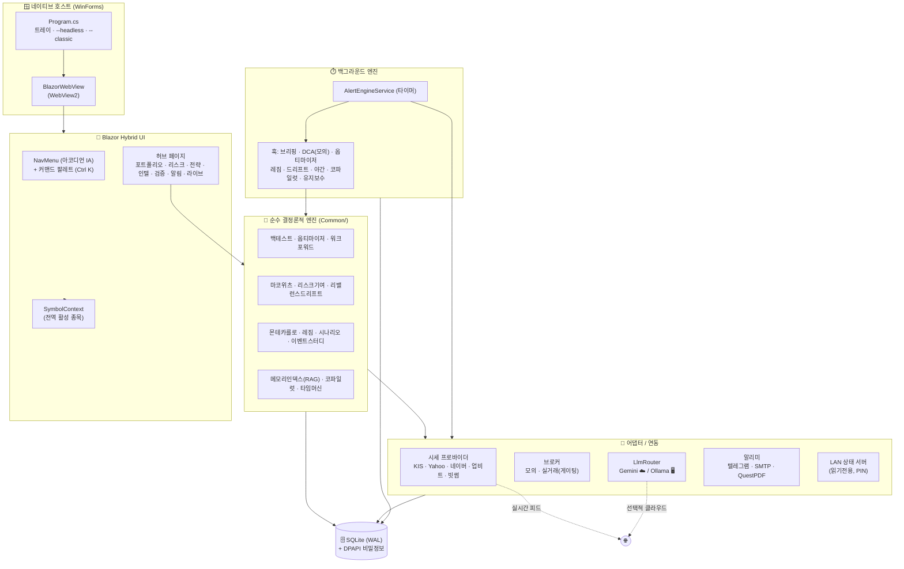

<div align="center">

# 📈 MS2-E Stock Suite

**프라이버시 우선 · 오프라인 가능한 한국/미국 주식·코인 퀀트 터미널.**
WinForms 호스트 · Blazor Hybrid UI · 순수 결정론적 분석 코어 · 로컬+클라우드 LLM.

[](#-테스트--ci)
[](#-테스트--ci)
[](#-빠른-시작)
[](#-버전-궤적)
[](#-라이선스)

[English](README.md) · **한국어**

</div>

---

## 한 줄 소개

MS2-E Stock Suite는 데스크톱 **퀀트 리서치·모니터링 터미널**입니다. 네이티브 Windows
호스트(WinForms + WebView2)와 최신 Blazor Hybrid UI를, **순수·결정론적·무의존 분석 엔진**
라이브러리 위에 올렸습니다 — 백테스트, 포트폴리오 최적화(MPT), 리스크 기여도, 레짐 탐지,
몬테카를로, 이벤트 스터디, 워크포워드 검증 등 — 각각 단위 테스트로 고정되어 있습니다.

**완전 오프라인·프라이빗**으로 동작할 수 있습니다: 로컬 SQLite, 비밀정보 at-rest 암호화
(DPAPI), 그리고 선택적 **로컬 LLM(Ollama)** — 프롬프트가 기기를 떠나지 않습니다. 원할 때만
클라우드 지능(Google Gemini)과 실시간 시세(KIS / Yahoo / 업비트 / 빗썸)를 어댑터로 연결합니다.

> **설계로 보장하는 안전 — 절대 실거래하지 않습니다.** 시스템이 만들어내는 모든 "행동"은
> *제안*, *모의(paper)* 거래, 또는 *읽기전용* 분석입니다. 실주문 경로 자체가 없습니다.

---

## 목차

- [핵심 기능](#-핵심-기능)
- [아키텍처](#-아키텍처)
- [설계 원칙](#-설계-원칙)
- [모듈 지도](#-모듈-지도)
- [빠른 시작](#-빠른-시작)
- [설치 파일](#-설치-파일)
- [환경 설정](#-환경-설정)
- [데이터·저장소](#-데이터저장소)
- [테스트·CI](#-테스트--ci)
- [버전 궤적](#-버전-궤적)
- [검증 경계(정직 표기)](#-검증-경계정직-표기)
- [라이선스](#-라이선스)

---

## ✨ 핵심 기능

| 영역 | 내용 |
|------|------|
| 📊 **마켓** | 실시간 시세(KIS / Yahoo / 네이버 / 업비트 / 빗썸), API 한도 방어 캔들 캐시, WebSocket 오버레이, 중복제거·감성 뉴스 레이더 |
| 💼 **포트폴리오·MPT** | 보유·배분, **마코위츠 최적화**(가우스-조던 역행렬 + 워터필링 상한), **드리프트 트리거** 리밸런싱 알림, 리스크 분해 |
| 🔬 **전략 연구소** | 시그널 엔진, **오버나잇 격자 옵티마이저**, **워크포워드 2.0**(과최적화 가드), 이벤트 스터디, 가설 발굴, 엣지 인지 **포지션 사이저**(켈리 + 변동성 타깃) |
| 🎲 **리스크·시뮬** | **몬테카를로** 포트폴리오 시뮬(촐레스키 상관), **시나리오 스튜디오**(베타 전파 조건부 스트레스), **리스크 기여도/패리티**(오일러 / MCTR) |
| 🤖 **AI·인텔리전스** | **로컬 RAG**("투자 두뇌", BM25 + CJK 바이그램) AI 비서, **멀티에이전트 토론**(강세/약세/심판), 인과 추적 저널, 레짐 변화 이상탐지 |
| 🧪 **검증 센터** | 반사실 **디지털 트윈**, **예측 스코어보드**(자기 보정도), 알림 신뢰도 **캘리브레이터**, 결정 **리플레이**, **타임머신** 샌드박스(무누수 재현+채점) |
| 🔔 **알림** | 통합 알림 센터, 자연어 복합 알림 컴파일러, 이력, 텔레그램 푸시, 야간 PDF/메일 퍼블리싱 |
| 🧰 **운영** | 목표주도 **코파일럿**, **진단 대시보드**, 주1회 DB 유지보수(VACUUM), 헤드리스 모드, 원클릭 설치 파일 |

---

## 🏛 아키텍처



**다이어그램 읽는 법:** UI와 백그라운드 엔진은 모두 **순수 코어**에 의존하고, 순수 코어는
데이터 외에 아무것에도 의존하지 않습니다. 모든 네트워크·LLM·IO는 가장자리의 **어댑터**에
격리되어, 분석 엔진은 결정론적이고 단위 테스트 가능한 상태를 유지합니다.

---

## 🧱 설계 원칙

1. **순수 코어("소수 패턴").** 모든 분석은 순수·결정론적·무의존 C# 함수입니다 — 같은 입력,
   같은 출력, 시계 없음, 네트워크 없음. 그래서 **334개 단위 테스트**가 수학을 고정할 수
   있습니다. 무거운 외부 라이브러리는 의도적으로 피합니다.
2. **어댑터 격리.** 시세·브로커·LLM·알리미·LAN 서버는 모두 얇은 어댑터 뒤에 있습니다. 코어는
   소켓을 직접 만지지 않습니다.
3. **게이팅 / 안전 우선.** 코드베이스에 실거래 자동매매가 존재하지 않습니다. 자동 DCA와
   코파일럿은 **모의 전용**, 옵티마이저는 **읽기전용**, 실주문 경로는 게이팅됩니다.
4. **프라이버시 우선·오프라인 가능.** 로컬 SQLite, **DPAPI** at-rest 암호화, 선택적
   **완전 로컬 LLM(Ollama)** — 외부 트래픽 0으로도 동작합니다. 원격 접속은 PIN 브루트포스
   잠금이 걸린 *읽기전용* LAN 서버일 뿐, 클라우드 동기화가 아닙니다.
5. **정직한 검증 경계.** 빌드 성공·단위 테스트는 *검증된 사실*입니다. UI 렌더링, WebSocket
   틱, LLM 응답, 실시간 네트워크는 *런타임 의존*이며 문서에서 "검증됨"으로 표기하지 않습니다
   — [아래 참고](#-검증-경계정직-표기).

---

## 🧩 모듈 지도

```
StockManager_v3.4.1/
├── README.md / README.ko.md       # ← 지금 보는 문서 (쇼케이스)
├── CONTRIBUTING.md
├── StockManager.sln
├── StockManager/                  # 본체 앱 (net8.0-windows, WinExe)
│   ├── Program.cs                 # 호스트: 트레이, --headless, --classic
│   ├── Common/                    # 61개 모듈 — 순수 코어 + 어댑터
│   │   ├── BacktestEngine · StrategyOptimizer · WalkForward
│   │   ├── MarkowitzOptimizer · RiskAttribution · RebalanceDrift
│   │   ├── MonteCarlo · RegimeDetector · ScenarioStudio · EventStudy
│   │   ├── HypothesisMiner · PositionSizer · CounterfactualTwin
│   │   ├── ForecastScore · AlertCalibrator · ReplayService · TimeMachine
│   │   ├── MemoryIndex (RAG) · CopilotEngine · CausalJournal · Diagnostics
│   │   ├── AiService · LlmProviders (Gemini/Ollama) · DebateService
│   │   ├── QuoteProviders · CryptoProviders · Broker · PaperBroker
│   │   ├── Database (SQLite/WAL/DPAPI) · DbMaintenance · LanStatusServer
│   │   ├── AlertEngineService · CompositeAlertService · AlertCenter
│   │   └── NightlyReport · EmailSender · TelegramNotifier · …
│   └── Blazor/Pages/              # 39개 페이지 — 허브 + 기능 페이지
├── StockManager.Tests/            # xUnit — 334개 테스트
├── StockManager.PrimesBench/      # 마이크로 벤치마크 하니스
└── installer/                     # Inno Setup 스크립트 + 빌드 가이드
```

---

## 🚀 빠른 시작

> **사전 준비:** Windows 10/11 · [.NET 8 SDK](https://dotnet.microsoft.com/download) ·
> [WebView2 런타임](https://developer.microsoft.com/microsoft-edge/webview2/)(최신 Windows는 기본 탑재).

```powershell
# 빌드
dotnet build StockManager.sln -c Release -m:1

# 실행 (데스크톱 UI)
dotnet run --project StockManager\StockManager.csproj

# 헤드리스 (백그라운드 엔진만 — 알림·야간 작업·LAN 서버)
dotnet run --project StockManager\StockManager.csproj -- --headless

# 릴리스 게시 (프레임워크 의존)
dotnet publish StockManager\StockManager.csproj -c Release -o StockManager\publish
```

> ⚠️ 키움 OpenAPI+는 32비트 전용입니다. 키움 실시간이 필요하면 x86으로 빌드:
> `dotnet build -c Release -p:PlatformTarget=x86`.

---

## 📦 설치 파일

**Inno Setup**으로 더블클릭 설치 파일을 만듭니다(사용자단위 설치·관리자 불필요·WebView2 점검·한/영):

```powershell
# 1) 앱 게시
dotnet publish StockManager\StockManager.csproj -c Release -o StockManager\publish
# 2) 설치 파일 컴파일
& "C:\Program Files (x86)\Inno Setup 6\ISCC.exe" installer\StockManager.iss
# → installer\Output\MS2E-StockSuite-Setup-3.41.0.exe
```

대상 PC에 .NET 미설치여도 되게 하려면 게시 단계에 `-r win-x64 --self-contained true`를
추가하세요. 전체 가이드: [`installer/README.md`](installer/README.md).

---

## ⚙️ 환경 설정

앱에서 **설정**(⚙️)을 엽니다. 비밀정보는 DPAPI(`enc:v1:` 마커)로 at-rest 암호화됩니다.

| 설정 | 발급처 |
|------|--------|
| **Gemini API 키** | https://aistudio.google.com/apikey |
| **KIS AppKey / Secret** | https://apiportal.koreainvestment.com (모의투자 먼저) |
| **Ollama** | [Ollama](https://ollama.com) 설치 → `ollama pull llama3.1` → 설정에서 활성화(기본 `http://localhost:11434`) |
| **텔레그램 토큰 / chat id** | @BotFather → 봇 생성 → chat id 조회 |
| **SMTP (야간 메일)** | 메일 제공자의 SMTP 호스트 / 포트 / 자격증명 |

LLM 백엔드는 `LlmRouter`가 선택합니다: `auto`는 키가 있으면 Gemini, 없으면 Ollama(활성 시),
둘 다 없으면 no-LLM. 진단 페이지(`/diagnostics`)에서 현재 백엔드를 보고 각 연동을 라이브
핑할 수 있습니다.

---

## 🗄️ 데이터·저장소

```
%LOCALAPPDATA%\StockManager\
├── portfolio.db        # SQLite (WAL) — 보유·시그널·알림·저널·설정
└── logs\
    └── stock_yyyyMMdd.log
```

주1회 백그라운드 훅이 `wal_checkpoint(TRUNCATE) + ANALYZE + VACUUM`을 실행해 DB를 컴팩트하게
유지하고, 핵심 테이블에는 핫 경로용 복합 인덱스가 걸려 있습니다.

---

## 🧪 테스트 · CI

```powershell
dotnet test StockManager.Tests\StockManager.Tests.csproj -c Release -m:1
```

- **334개 단위 테스트**가 순수 분석 코어를 검증합니다(결정성, 고정 시드 재현성, 경계 조건,
  단조성 성질).
- **GitHub Actions**(`.github/workflows/ci.yml`): 모든 푸시는 `windows-latest`에서 빌드+테스트,
  `v*` 태그 푸시는 게시→zip→GitHub Release 업로드까지 자동화.

---

## 🗺 버전 궤적

요약(전체 이력은 [`StockManager/PROGRESS.md`](StockManager/PROGRESS.md)):

| 구간 | 테마 |
|------|------|
| v2.2 – v2.3 | WinForms 5프로그램 모음 — 시세·포트폴리오·AI·뉴스·시그널 |
| v3.1 – v3.7 | **Blazor Hybrid 이식**, SQLite 하드닝(WAL + 재시도), DPAPI 비밀정보, WebSocket 오버레이 |
| v3.8 – v3.16 | AI 비서 + 아침 브리핑, 결정 리플레이, NL 알림 컴파일러, 헤드리스, 몬테카를로, 오버나잇 옵티마이저, 인과 저널 |
| v3.17 – v3.28 | 워크포워드 2.0, 로컬 RAG 두뇌, 레짐 이상탐지, **MPT 옵티마이저**, 디지털 트윈, 캘리브레이터, 이벤트 스터디, 시나리오 스튜디오, 리스크 패리티, 예측 스코어보드, 가설 발굴, 포지션 사이저 |
| v3.29 – v3.33 | **내비게이션 IA 전면 개편**(허브 · 아코디언 · 전역 종목 컨텍스트 · 드리프트 트리거) |
| v3.34 – v3.38 | **Season 4** — 로컬 LLM(Ollama), 멀티에이전트 토론, 야간 퍼블리싱, 목표주도 코파일럿, 타임머신 샌드박스 |
| v3.39 – v3.41 | **운영화** — DB 유지보수, Ollama 타임아웃, CI 릴리스 패키징, 진단 대시보드, **Inno Setup 설치 파일** |

---

## ⚖️ 검증 경계(정직 표기)

이 프로젝트는 *증명된 것*과 *런타임 의존*을 의도적으로 구분합니다:

- ✅ **자동 검증됨:** Release 빌드(0 에러 / 0 경고)와 334개 단위 테스트.
- 🟡 **런타임 의존(사용자 검증):** UI 렌더링, WebSocket 실시간 틱, Gemini LLM 응답, LAN/원격
  접속, 실시간 시세 수집. 사용자 기기·네트워크·외부 서비스에 의존하므로 문서에서 "검증됨"으로
  표기하지 **않습니다**.

---

## 📜 라이선스

독점(Proprietary) — © Angtec Engineering. 서드파티 구성요소:

- **Microsoft.Data.Sqlite** — MIT
- **QuestPDF** — Community License (연 매출 USD 100만 미만 무료)
- **Gemini API** — Google AI Studio (무료 티어 지원)

## 🙏 Credits

Angtec Engineering — 이근식 (gslee@angtec.com). MS2-E 통합 업무 매니저 플랫폼 기반.
Claude(Anthropic)와의 엔지니어링 협업.
