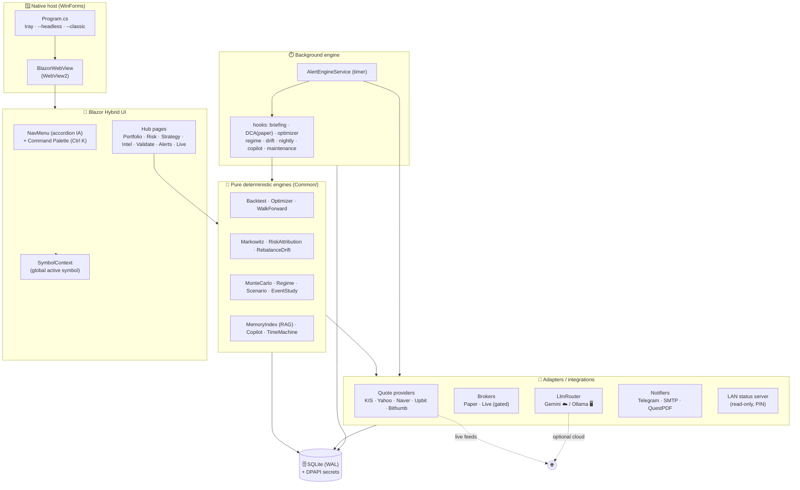

<div align="center">

# 📈 MS2-E Stock Suite

**A privacy-first, offline-capable quant terminal for Korean & US equities and crypto.**
WinForms host · Blazor Hybrid UI · pure-deterministic analytics core · local + cloud LLM.

[](#-testing--ci)
[](#-testing--ci)
[](#-quick-start)
[](#-version-trajectory)
[](#-license)

**English** · [한국어](README.ko.md)

</div>

---

## What is this?

MS2-E Stock Suite is a desktop **quant research & monitoring terminal**. It pairs a native
Windows host (WinForms + WebView2) with a modern Blazor Hybrid UI, on top of a large library
of **pure, deterministic, dependency-free analytic engines** — backtesting, portfolio
optimization (MPT), risk attribution, regime detection, Monte-Carlo simulation, event studies,
walk-forward validation, and more — each fully unit-tested.

It can run **fully offline and private**: a local SQLite store, secrets encrypted at rest
(DPAPI), and an optional **local LLM (Ollama)** so no prompt ever leaves the machine. When you
want it, cloud intelligence (Google Gemini) and live market feeds (KIS / Yahoo / Upbit /
Bithumb) plug in behind adapters.

> **Safety by design — never trades real money.** Every "action" the system produces is a
> *proposal*, a *paper* trade, or a *read-only* analysis. There is no real-money order path.

---

## Table of contents

- [Highlights](#-highlights)
- [Architecture](#-architecture)
- [Design principles](#-design-principles)
- [Module map](#-module-map)
- [Quick start](#-quick-start)
- [Installer](#-installer)
- [Configuration](#-configuration)
- [Data & storage](#-data--storage)
- [Testing & CI](#-testing--ci)
- [Version trajectory](#-version-trajectory)
- [Verification boundary (honest)](#-verification-boundary-honest)
- [License](#-license)

---

## ✨ Highlights

| Area | What you get |
|------|--------------|
| 📊 **Market** | Live quotes (KIS / Yahoo / Naver / Upbit / Bithumb), candle caching to defend API limits, WebSocket overlay, news radar with de-dup + sentiment |
| 💼 **Portfolio & MPT** | Holdings, allocation, **Markowitz optimizer** (Gauss-Jordan inverse + water-filling caps), rebalancing with **drift trigger** alerts, risk decomposition |
| 🔬 **Strategy Lab** | Signal engine, **overnight grid optimizer**, **walk-forward 2.0** (overfit guard), event-study engine, hypothesis miner, edge-aware **position sizer** (Kelly + vol-target) |
| 🎲 **Risk & Sim** | **Monte-Carlo** portfolio simulation (Cholesky-correlated), **Scenario Studio** (conditional stress via beta propagation), **risk attribution / parity** (Euler / MCTR) |
| 🤖 **Intelligence** | AI assistant with **local RAG** ("investment brain", BM25 + CJK bigram), **multi-agent debate** (bull/bear/judge), causal-tracking journal, regime-change anomaly detection |
| 🧪 **Validation** | Counterfactual **digital twin**, **forecast scoreboard** (self-calibration), alert-reliability **calibrator**, decision **replay**, **time-machine** sandbox (look-ahead-free replay + scoring) |
| 🔔 **Alerts** | Unified alert center, natural-language composite alert compiler, history, Telegram push, nightly PDF/email publishing |
| 🧰 **Ops** | Goal-driven **copilot**, **diagnostics dashboard**, weekly DB maintenance (VACUUM), headless mode, one-click installer |

---

## 🏛 Architecture



**Reading the diagram:** the UI and the background engine both depend on the **pure core**;
the pure core depends on nothing but data. All network, LLM, and IO live in **adapters** at the
edge, so the analytic engines stay deterministic and unit-testable.

---

## 🧱 Design principles

1. **Pure-core ("Primes pattern").** Every analytic is a pure, deterministic, dependency-free
   C# function — same input, same output, no clock, no network. That is why **334 unit tests**
   can pin the math. Heavy external libraries are avoided on purpose.
2. **Adapter isolation.** Market feeds, brokers, LLMs, notifiers, and the LAN server are all
   behind thin adapters. The core never touches a socket.
3. **Gating / safety-first.** No real-money auto-trading exists in the codebase. Auto-DCA and
   the copilot are **paper-only**; the optimizer is **read-only**; live order paths are gated.
4. **Privacy-first & offline-capable.** Local SQLite, secrets encrypted at rest with **DPAPI**,
   and an optional **fully-local LLM (Ollama)** mean the app can run with zero outbound traffic.
   Remote access is a *read-only* LAN server with PIN brute-force lockout — never a cloud sync.
5. **Honest verification boundary.** Build success and unit tests are *verified facts*. UI
   rendering, WebSocket ticks, LLM responses, and live network are *runtime-dependent* and are
   never claimed as "verified" in docs — see [below](#-verification-boundary-honest).

---

## 🧩 Module map

```
StockManager_v3.4.1/
├── README.md / README.ko.md       # ← you are here (showcase)
├── CONTRIBUTING.md
├── StockManager.sln
├── StockManager/                  # main app (net8.0-windows, WinExe)
│   ├── Program.cs                 # host: tray, --headless, --classic
│   ├── Common/                    # 61 modules — pure core + adapters
│   │   ├── BacktestEngine · StrategyOptimizer · WalkForward
│   │   ├── MarkowitzOptimizer · RiskAttribution · RebalanceDrift
│   │   ├── MonteCarlo · RegimeDetector · ScenarioStudio · EventStudy
│   │   ├── HypothesisMiner · PositionSizer · CounterfactualTwin
│   │   ├── ForecastScore · AlertCalibrator · ReplayService · TimeMachine
│   │   ├── MemoryIndex (RAG) · CopilotEngine · CausalJournal · Diagnostics
│   │   ├── AiService · LlmProviders (Gemini/Ollama) · DebateService
│   │   ├── QuoteProviders · CryptoProviders · Broker · PaperBroker
│   │   ├── Database (SQLite/WAL/DPAPI) · DbMaintenance · LanStatusServer
│   │   ├── AlertEngineService · CompositeAlertService · AlertCenter
│   │   └── NightlyReport · EmailSender · TelegramNotifier · …
│   └── Blazor/Pages/              # 39 pages — hubs + feature pages
├── StockManager.Tests/            # xUnit — 334 tests
├── StockManager.PrimesBench/      # micro-benchmark harness
└── installer/                     # Inno Setup script + build guide
```

---

## 🚀 Quick start

> **Prerequisites:** Windows 10/11 · [.NET 8 SDK](https://dotnet.microsoft.com/download) ·
> [WebView2 runtime](https://developer.microsoft.com/microsoft-edge/webview2/) (preinstalled on
> most current Windows).

```powershell
# build
dotnet build StockManager.sln -c Release -m:1

# run (desktop UI)
dotnet run --project StockManager\StockManager.csproj

# headless (background engine only — alerts, nightly jobs, LAN server)
dotnet run --project StockManager\StockManager.csproj -- --headless

# release publish (framework-dependent)
dotnet publish StockManager\StockManager.csproj -c Release -o StockManager\publish
```

> ⚠️ Kiwoom OpenAPI+ is 32-bit only. If you need Kiwoom realtime, build x86:
> `dotnet build -c Release -p:PlatformTarget=x86`.

---

## 📦 Installer

A one-double-click Windows installer is produced with **Inno Setup** (user-level install, no
admin required, WebView2 check, Korean/English):

```powershell
# 1) publish the app
dotnet publish StockManager\StockManager.csproj -c Release -o StockManager\publish
# 2) compile the installer
& "C:\Program Files (x86)\Inno Setup 6\ISCC.exe" installer\StockManager.iss
# → installer\Output\MS2E-StockSuite-Setup-3.41.0.exe
```

For a self-contained build (no .NET runtime needed on the target PC), add
`-r win-x64 --self-contained true` to the publish step. Full guide:
[`installer/README.md`](installer/README.md).

---

## ⚙️ Configuration

Open **Settings** (⚙️) in the app. Secrets are encrypted at rest via DPAPI (`enc:v1:` marker).

| Setting | Where to get it |
|---------|-----------------|
| **Gemini API key** | https://aistudio.google.com/apikey |
| **KIS AppKey / Secret** | https://apiportal.koreainvestment.com (start with paper trading) |
| **Ollama** | install [Ollama](https://ollama.com), `ollama pull llama3.1`, enable in Settings (defaults to `http://localhost:11434`) |
| **Telegram token / chat id** | @BotFather → create bot → fetch chat id |
| **SMTP (nightly email)** | your mail provider's SMTP host / port / credentials |

The LLM backend is chosen by `LlmRouter`: `auto` prefers Gemini if a key is present, otherwise
falls back to Ollama if enabled, otherwise no-LLM. The diagnostics page (`/diagnostics`) shows
the active backend and can ping each integration live.

---

## 🗄️ Data & storage

```
%LOCALAPPDATA%\StockManager\
├── portfolio.db        # SQLite (WAL mode) — holdings, signals, alerts, journals, settings
└── logs\
    └── stock_yyyyMMdd.log
```

A weekly background hook runs `wal_checkpoint(TRUNCATE) + ANALYZE + VACUUM` to keep the DB
compact; core tables carry composite indexes for hot query paths.

---

## 🧪 Testing & CI

```powershell
dotnet test StockManager.Tests\StockManager.Tests.csproj -c Release -m:1
```

- **334 unit tests** cover the pure analytic core (determinism, reproducibility under fixed
  seeds, boundary conditions, monotonicity properties).
- **GitHub Actions** (`.github/workflows/ci.yml`): every push builds + tests on
  `windows-latest`; pushing a `v*` tag publishes, zips, and uploads a GitHub Release.

---

## 🗺 Version trajectory

A condensed view (full history in [`StockManager/PROGRESS.md`](StockManager/PROGRESS.md)):

| Range | Theme |
|-------|-------|
| v2.2 – v2.3 | WinForms 5-program suite — quotes, portfolio, AI, news, signals |
| v3.1 – v3.7 | **Blazor Hybrid migration**, SQLite hardening (WAL + retry), DPAPI secrets, WebSocket overlay |
| v3.8 – v3.16 | AI assistant + morning brief, decision replay, NL alert compiler, headless mode, Monte-Carlo, overnight optimizer, causal journal |
| v3.17 – v3.28 | Walk-forward 2.0, local RAG brain, regime anomaly, **MPT optimizer**, digital twin, calibrator, event study, scenario studio, risk parity, forecast scoreboard, hypothesis miner, position sizer |
| v3.29 – v3.33 | **Navigation IA overhaul** (hubs · accordion · global symbol context · drift trigger) |
| v3.34 – v3.38 | **Season 4** — local LLM (Ollama), multi-agent debate, nightly publishing, goal-driven copilot, time-machine sandbox |
| v3.39 – v3.41 | **Ops** — DB maintenance, Ollama timeout hardening, CI release packaging, diagnostics dashboard, **Inno Setup installer** |

---

## ⚖️ Verification boundary (honest)

This project deliberately separates *proven* from *runtime-dependent* claims:

- ✅ **Verified by automation:** Release build (0 errors / 0 warnings) and 334 unit tests.
- 🟡 **Runtime-dependent (user-verified):** UI rendering, WebSocket realtime ticks, Gemini LLM
  responses, LAN/remote access, and live market-data collection. These depend on the user's
  machine, network, and third-party services and are **not** marked "verified" in docs.

---

## 📜 License

Proprietary — © Angtec Engineering. Third-party components:

- **Microsoft.Data.Sqlite** — MIT
- **QuestPDF** — Community License (free under USD 1M annual revenue)
- **Gemini API** — Google AI Studio (free tier available)

## 🙏 Credits

Angtec Engineering — 이근식 (gslee@angtec.com). Built on the MS2-E integrated work-manager
platform. Engineering collaboration with Claude (Anthropic).
